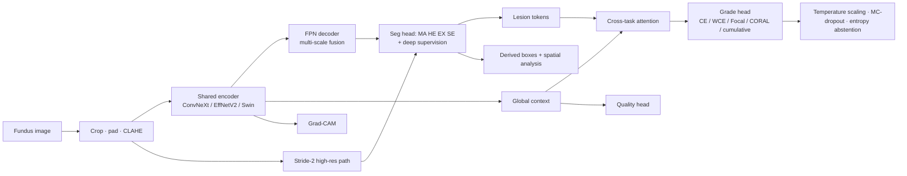

# Retina-Lens-AI 🩺👁️

**Retina-Lens-AI** is a multi-task deep learning pipeline and interactive Streamlit web application designed for comprehensive retinal image analysis, specializing in Diabetic Retinopathy (DR) grading, lesion segmentation, image quality assessment, and model explainability.

---

## 🚀 Key Features

* **Multi-Task Learning Architecture (`MultiTaskNet`):** Shares a robust backbone encoder (ConvNeXt / EfficientNetV2 / Swin) coupled with an FEN decoder for simultaneous DR severity grading and lesion segmentation.
* **Granular Lesion Detection:** Targets key clinical biomarkers including Microaneurysms (MA), Haemorrhages (HE), Hard Exudates (EX), and Soft Exudates (SE).
* **Advanced Severity Grading:** Supports ordinal regression (CORAL) alongside standard cross-entropy objectives.
* **Interactive Streamlit Dashboard:** Features real-time local model validation, diagnostic preview modes, uncertainty estimations, and explainability tabs.
* **Robust Automation:** Includes streamlined CLI scripts for single-image inference and automated batch CSV submission generation.

---

## 📁 Project Structure

```text
retina-lens-ai/
├── app/                  # Streamlit dashboard application
├── configs/              # YAML configuration files (e.g., aptos.yaml)
├── data/                 # Dataset manifests and raw/processed directories
├── src/                  # Core package source code (models, losses, inference)
├── tests/                # Unit tests and smoke checks
├── predict.py            # Single-image inference script
├── generate_submission.py# Automated batch test prediction script
└── README.md

Multi-task deep learning for diabetic retinopathy (DR) from fundus photographs: **5-class ordinal grading**, **4-class lesion segmentation** (MA, HE, EX, SE), **lesion boxes**, **image-quality assessment**, **uncertainty**, **Grad-CAM explainability**, **spatial lesion analysis**, a **FastAPI** service and an interactive **Streamlit** dashboard.

> ⚠️ **Research prototype. Not a medical device. Not clinically validated.** Outputs are research predictions, never diagnoses.
>
> **Results status: none yet.** This repository contains the full pipeline, but *no model has been trained in its creation*, so there are **no performance numbers anywhere in this README**. The "Experimental results" section is filled only from `runs/*/metrics_test.json` after you train (`scripts/compare.py` generates the table).

## 1. Problem & objectives
DR screening needs (a) a severity grade, (b) evidence of *where* disease is, and (c) knowing when **not** to trust a prediction. Objectives:
1. Ordinal grading (QWK-driven) vs. nominal-classification baselines.
2. Lesion segmentation that preserves tiny microaneurysms (high-res pathway).
3. Train on **heterogeneous annotations** without treating missing labels as negatives.
4. Test whether lesion-aware cross-task attention helps grading (ablation).
5. Calibrated, abstaining predictions; honest explainability.

## 2. Architecture

Key design points: validity-masked losses (`losses.py`), Kendall uncertainty weighting option, CORAL rank-consistent ordinal head, global features always concatenated with lesion features (the 4 lesion classes don't cover all DR signs, e.g. IRMA/neovascularisation).

## 3. Annotation availability (what the adapters assume)
| Dataset | Grade | MA/HE/EX/SE masks | Boxes | OD/Fovea | Notes |
|---|---|---|---|---|---|
| IDRiD | ✅ | ✅ (subset; SE not for every image) | ❌ | ✅ (not yet consumed by adapter) | patient id unavailable → image-level split |
| DDR | ✅ (grade 5 = ungradable → quality=bad) | ✅ (separate subset) | release provides boxes (not yet used) | ❌ | |
| FGADR | ✅ | ✅ (Seg-set) | ❌ | ❌ | |
| APTOS 2019 | ✅ | ❌ | ❌ | ❌ | Kaggle rules/licence apply |

Folder layouts are coded from the public releases; **verify against your copy** (`python -m retina_lens.data.manifest` prints real counts and fails on integrity problems). Unfound masks are `valid_*=False` (unknown). Set `missing_mask_means_negative: true` only if you verified that protocol. **Licences differ per dataset - check each before redistributing or publishing.** Never commit data.

## 4. Implemented vs. planned (honest scope)
| Component | Status |
|---|---|
| Adapters, manifest, grouped splits, integrity checks | ✅ implemented |
| Preprocessing, aug with synchronized masks, quality heuristics | ✅ |
| Multi-task net (3 backbones), FPN + hi-res seg, CORAL/CE/WCE/Focal/cumulative | ✅ |
| Validity-masked multi-task loss; fixed & uncertainty weighting | ✅ |
| Training: AdamW, warmup+cosine, AMP, clipping, early stop, resume, MLflow | ✅ |
| Evaluation: QWK, F1, AUROC, sens/spec, ECE, Brier, bootstrap CI, temperature scaling | ✅ |
| Seg metrics (Dice/IoU/lesion-wise) | ✅ functions in `metrics.py`; test-set seg report script **not yet wired** |
| Grad-CAM, overlays, spatial analysis, boxes derived from masks | ✅ |
| FastAPI, Streamlit (9 pages), PDF report, Docker, CI, tests | ✅ |
| **Standalone detector** (Faster R-CNN / RetinaNet / YOLO) | ❌ planned. Current boxes are *derived from masks* (merging touching lesions; no independent localisation) |
| U-Net vs U-Net++ ablation, RETFound backbone, GradNorm, patch-based MA training, OOD experiments (`ood_auroc` provided) | ❌ planned |
| Boundary metrics, mAP | ❌ planned (needs a real detector) |

The code was written without GPU/dataset access and **has not been executed end-to-end by the author of this scaffold**; first run `pytest` and the CPU smoke test, expect to fix small issues against your dataset copies.

## 5. Quick start (Windows / VS Code)
```powershell
python -m venv .venv; .venv\Scripts\activate
pip install torch torchvision          # pick the build for your CUDA/CPU from pytorch.org
pip install -e ".[app,track,dev]"
pytest -q                              # unit + CPU smoke training on SYNTHETIC data
python -m retina_lens.train --config configs/debug_cpu.yaml   # pipeline smoke test (not a real model)
```
### Real data
```powershell
copy configs\datasets.example.yaml configs\datasets.yaml      # edit paths (forward slashes)
python -m retina_lens.data.manifest --config configs/default.yaml
python -m retina_lens.train --config configs/default.yaml     # resume: --resume runs/<name>/last.pt
python -m retina_lens.evaluate --run runs/convnext_coral_mt   # val-fit temperature, test metrics + CIs
python scripts/run_experiments.py --exp exp2_ordinal          # structured experiments (add --debug for CPU)
python scripts/compare.py                                     # results/comparison.csv
mlflow ui                                                     # experiment tracking
```
**Colab:** `pip install -e ".[track]"` after cloning, mount Drive for data/`runs/`, run the same commands; `last.pt` is saved every epoch so interrupted sessions resume. Use `data.img_size: 512` (try 768+ for MA), `batch_size` 4-8, `amp: true` on a T4.

### Serve
```powershell
$env:RETINA_CHECKPOINT="runs/convnext_coral_mt/best.pt"
uvicorn retina_lens.api.main:app --port 8000      # docs at /docs
streamlit run app/dashboard.py                    # dashboard
docker compose up --build                         # mounts checkpoint read-only
```
No checkpoint ⇒ API returns **503** and the dashboard says inference is unavailable. *Demonstration mode* (sidebar) shows **synthetic, clearly-banner-labelled** data only for UI preview.

### API
`GET /health` · `GET /model-info` · `POST /predict` (multipart `file`; JPEG/PNG; size and decode validation; returns grade, probabilities, entropy, abstain flag, lesion counts, derived boxes, optional overlay PNG, timing, model version).

## 6. Evaluation methodology
Splits: grouped/stratified per dataset (80/10/10), seeded; test split is never read by `train.py`. Hyper-parameters and the abstention entropy threshold must be tuned on **val only**. Temperature is fitted on val and applied to test. 95% CIs via bootstrap (1000 resamples). External validation: train on a subset of datasets and evaluate on a held-out dataset by editing `data.datasets` and the manifest split (not automated yet). Report class imbalance from `integrity_report`.

## 7. Explainability: what the maps mean
- **Grad-CAM**: attribution of the grading output wrt. the last encoder map. Coarse, not lesion localisation, not proof of reasoning.
- **Segmentation masks**: *learned predictions* supervised by expert masks; they can be wrong.
- **Ground truth**: only expert annotations.

## 8. Experimental results
*Empty on purpose.* Run experiments, then paste the output of `scripts/compare.py` here with the commit hash and seed.

## 9. Limitations
Single-field 2D fundus only; dataset/camera shift; ordinal labels are noisy (inter-grader variability); 4 lesion classes ≠ all DR signs; pixel-unit spatial stats; heuristic quality thresholds need tuning; CPU inference of ConvNeXt at 512 px is slow-ish; no prospective or clinical validation.

## 10. Risks & mitigations
Class imbalance (weighted loss/sampler) · tiny MAs (hi-res path, larger input, future patch training) · label heterogeneity (validity masks) · compute (Colab T4, AMP, small backbones) · leakage (grouped splits + integrity assert) · over-confidence (temperature scaling, MC-dropout, abstention).

## 11. Repo layout
```
configs/   default.yaml  debug_cpu.yaml  datasets.example.yaml
src/retina_lens/  data/{schema,adapters,splits,manifest,preprocess,dataset}.py  models/multitask.py
                  losses.py train.py evaluate.py metrics.py uncertainty.py explain.py spatial.py inference.py report.py api/main.py
app/dashboard.py   scripts/{run_experiments,compare}.py   tests/   Dockerfile  docker-compose.yml  .github/workflows/ci.yml
```
Large checkpoints: keep out of git (`*.pt` ignored); use Git LFS, Hugging Face Hub, or a release asset; DVC can track `data/` and `runs/`.

## 12. References
Cao et al., CORAL (2020) · Kendall et al., multi-task uncertainty weighting (2018) · Zhou et al., UNet++ (2018) · Lin et al., FPN (2017) · Liu et al., ConvNeXt (2022) / Swin (2021) · Tan & Le, EfficientNetV2 (2021) · Zhou et al., RETFound (Nature 2023) · IDRiD (Porwal et al. 2018) · DDR (Li et al. 2019) · FGADR (Zhou et al. 2020) · APTOS 2019 (Kaggle). Verify exact citations and licences before publication.
